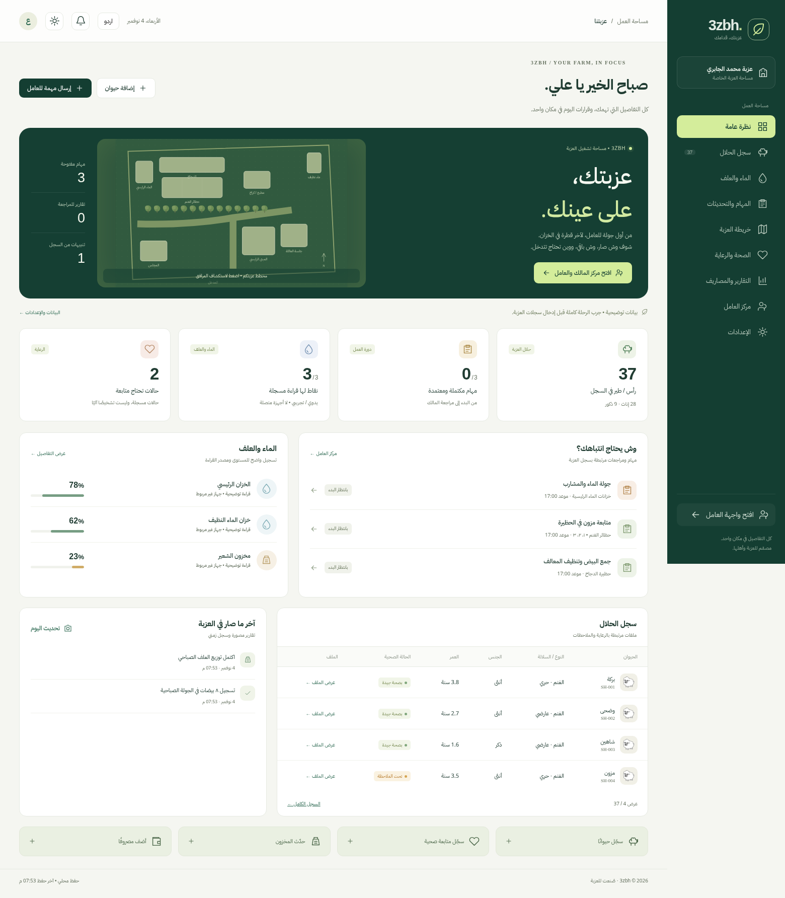
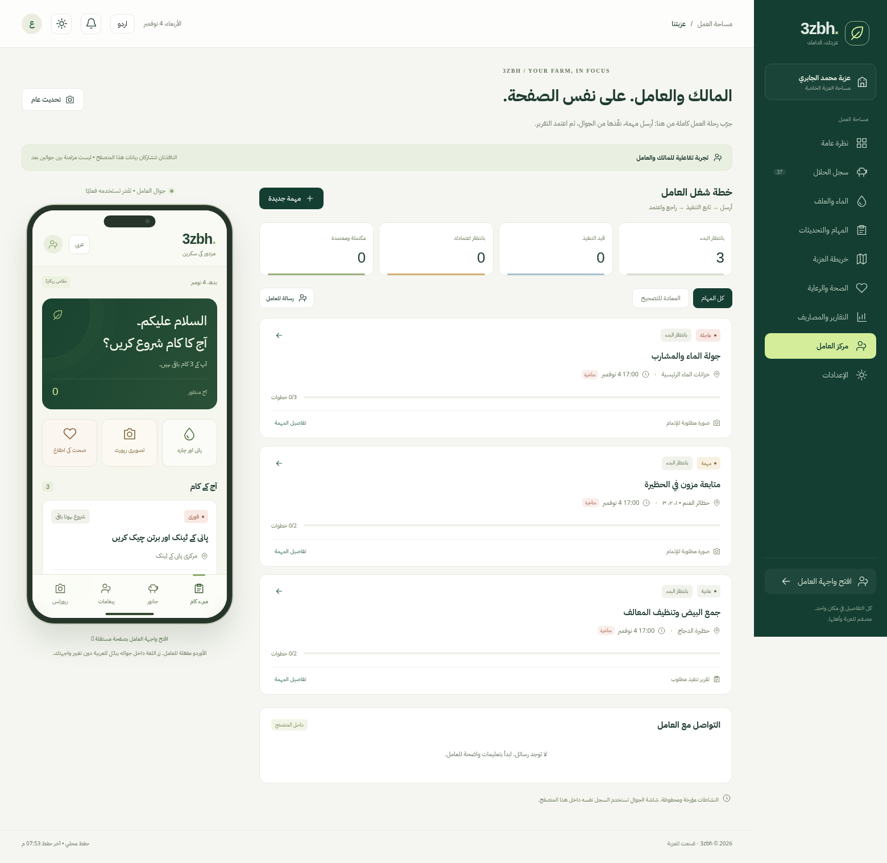
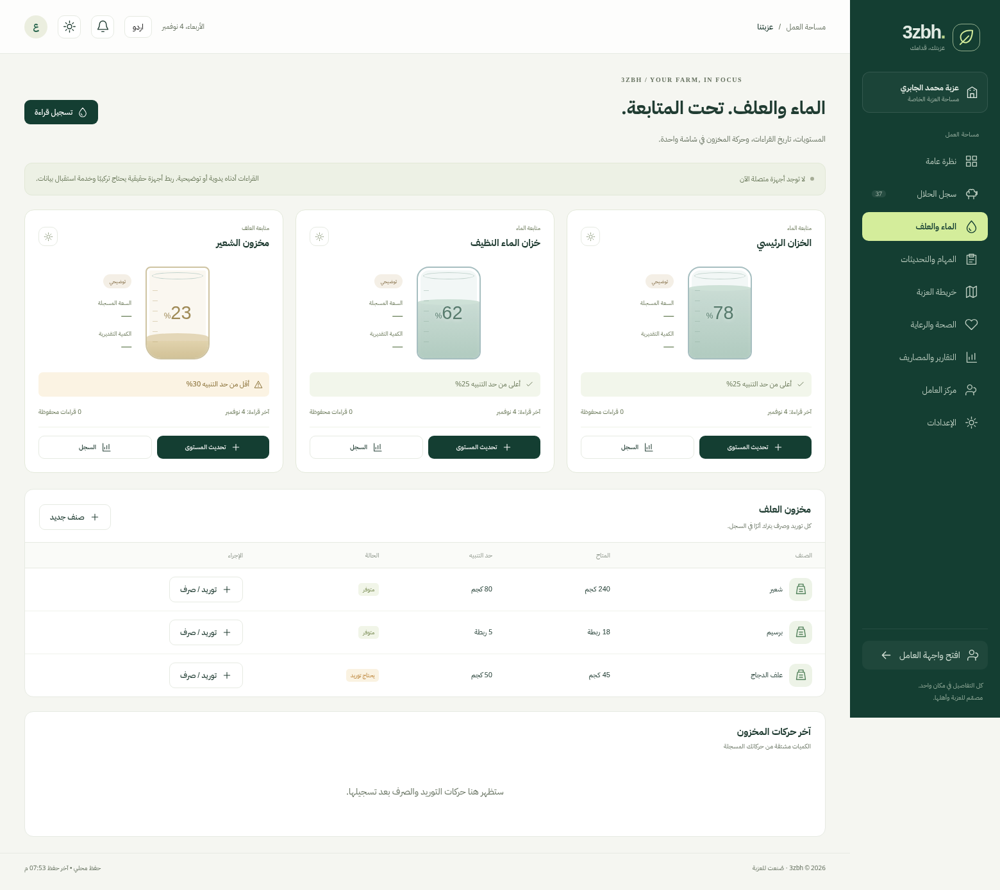
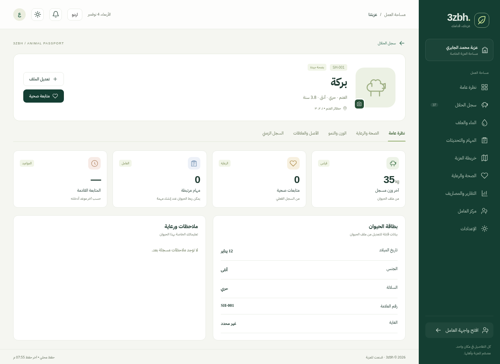
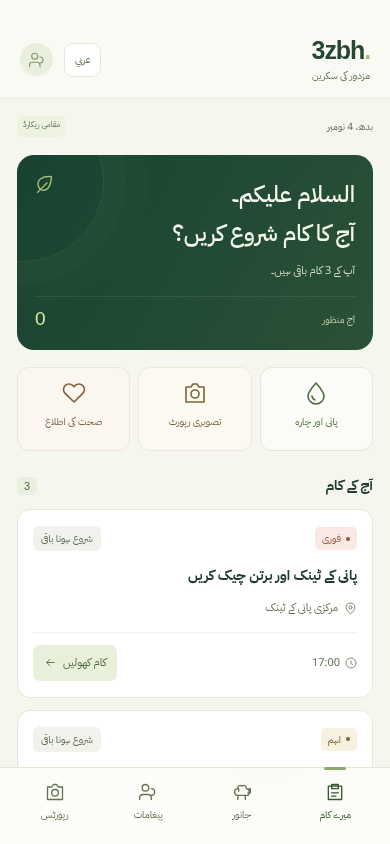

# 3zbh — مراجعة وتجربة النسخة التشغيلية

الهدف: يتخذ المالك إجراءً واضحًا، وينفذه العامل من واجهة جوال، ثم يرجع الأثر إلى المالك. بيانات الصور أمثلة معلّمة، والاتصال محلي بين إطارين في المتصفح، وليس بين جهازين مستقلين.

## ١. لوحة المالك — تعمل

الأرقام مشتقة من السجل، والمهام المفتوحة تصل إلى ملفاتها مباشرة. زر مركز العامل يقود إلى تجربة التنفيذ. بقيت قراءات الأجهزة مصنفة يدوية أو توضيحية، دون «متصل» وهمي.

## ٢. الإرسال والتنفيذ والمراجعة — تعمل

المراجعة الأولية وجدت أزرارًا منفصلة لا تقدم حلقة تنفيذ واعتماد. أصبح لكل مهمة موقع وأولوية وموعد وخطوات عربية وأوردو وصورة اختيارية أو إلزامية. اختُبر الإرسال إلى الإطار، البدء، منع الإتمام قبل إكمال الخطوات، إرسال الصورة، طلب التصحيح، إعادة الإرسال، ثم الاعتماد. الرسائل وعلامة القراءة اختُبرتا في الاتجاهين. هذه انتقالات فعلية في الحالة المحلية.

أُصلح خلل رسالة الخطأ القديمة بعد التصحيح، وإظهار خطأ العمليات داخل النموذج. يحتفظ النظام بالتقارير السابقة عند إعادة الإرسال. لا يُعاد إنشاء إطار الجوال عندما يحدث تحديث في لوحة المالك، لحفظ النموذج الذي يكتبه العامل.

## ٣. الماء والعلف والمخزون — تعمل محليًا

تعبئة مرئية مرتبطة بالقيمة المسجلة، تاريخ قراءات، حد تنبيه وسعة اختيارية لحساب كمية تقديرية. لا يوجد بث أجهزة فعلي. التوريد والصرف يسجلان قبل/بعد الكمية، وتُرفض محاولة صرف كمية أكبر من المتاح. اختُبرت الكميات الكسرية والحفظ وإعادة الفتح.

## ٤. ملف الحيوان — يعمل

هوية وصورة ووزن وصحة وعمر، مع تبويبات للرعاية والقياسات والأصل والسجل الزمني. الرسم البياني لا يعرض بيانات مخترعة؛ يبدأ بعد إدخال القياسات. اختُبر تحميل الصورة، إدخال قياسين، إظهار المنحنى، حفظ الغرض والموقع، ثم إعادة فتح الصفحة.

## ٥. جوال العامل — يعمل

الأوردو مستقلة عن لغة لوحة المالك. الأزرار الأساسية أكبر، والمهام والتقارير والرسائل والحلال في تنقل سفلي. اختُبر قياس شاشة 390×844 وعدم وجود تجاوز أفقي، وفتح واجهة العامل في تبويب جديد، والعمل بعد انقطاع الإنترنت عقب تحميل الأصول.

## نتيجة التحقق وحدوده

- اجتازت الاختبارات الوظيفية الثلاثة. خُصصت جولات متكررة للإضافة والتحقق والتصحيح والمراجعة، وليس لفحص البنية النحوية فقط.
- اجتازت نسخة `dist` اختبار إرسال مهمة إلى الجوال، الملف الكامل، عرض الجوال، والفتح دون إنترنت.
- كشف axe مشاكل تباين وأزرار أيقونات بلا أسماء ودلالة صورة تحتوي عناصر تفاعلية. تم تصحيحها، ولم تعد الفحوص الآلية على الحالات الأربع: overview وworker وsensors وfield تسجل مخالفات ضمن WCAG A/AA المحددة. هذا لا يثبت مطابقة كاملة ولا يستبدل اختبار قارئ شاشة أو مستخدم فعلي.
- الحفظ في المتصفح قابل للفقد عند مسح بياناته. لا يوجد تسجيل دخول آمن أو مزامنة بين جوالات مستقلة. النسخ الاحتياطي متاح، ويُنزل قبل بدء سجل فارغ.
- لا أجهزة حساسات موصولة، ولا تشخيص صحي آلي، ولا إحداثيات مستخرجة من الصورة.
- صور هذه المراجعة من Chromium محلي على النسخة المبنية؛ لا تثبت اكتمال نشر GitHub Pages.

## البحث الذي أثر على التنفيذ

تمت قراءة المصادر الرسمية التالية عبر Git؛ الزيارة المباشرة لبعض مواقع المنتجات حُجبت من بيئة العمل. لا ندعي تصفح واجهات خاصة أو حسابات منافسين.

- [farmOS: إدارة الأصول](https://github.com/farmOS/farmOS/blob/d868bd4e556d84c9e61316eb120ea11a3a53f3db/docs/guide/assets.md): النوع والسلالة، الحيوان كفرد أو مجموعة، ربطه بموقع، وملفات الرعاية. أثر ذلك على ملف الحيوان وعلاقاته والمهمة المرتبطة به.
- [farmOS: السجلات والأحداث](https://github.com/farmOS/farmOS/blob/d868bd4e556d84c9e61316eb120ea11a3a53f3db/docs/guide/logs.md): تخطيط المهام والسجلات المؤرخة، الفحوص والولادات، وربط السجل بالأصل. أثر ذلك على دورة تنفيذ المهمة وسجلها الزمني.
- [farmOS: حركة المخزون](https://github.com/farmOS/farmOS/blob/d868bd4e556d84c9e61316eb120ea11a3a53f3db/docs/guide/inventory.md): التوريد والصرف كسجلات تغير الكمية. أثر ذلك على سجل الحركات بدل الاكتفاء باستبدال عدد.
- [Field Kit README](https://github.com/farmOS/farmOS-client/blob/e72ce401ae6aa987d7c28f67dce3a64ee9020931/README.md) و[شاشة المهام في المصدر](https://github.com/farmOS/farmOS-client/blob/e72ce401ae6aa987d7c28f67dce3a64ee9020931/packages/field-module-tasks/src/components/TasksAll.vue): واجهة ميدانية تعمل دون إنترنت ومهام مرتبطة بمواقع وأصول. أثر ذلك على فصل واجهة العامل وبقائها قابلة للاستخدام مستقلّة.

التنفيذ هنا مستقل، ولا يتضمن نسخ كود واجهات تلك المنتجات. هذه مصادر لقرارات سير العمل، وليست ادعاء تكامل معها.
